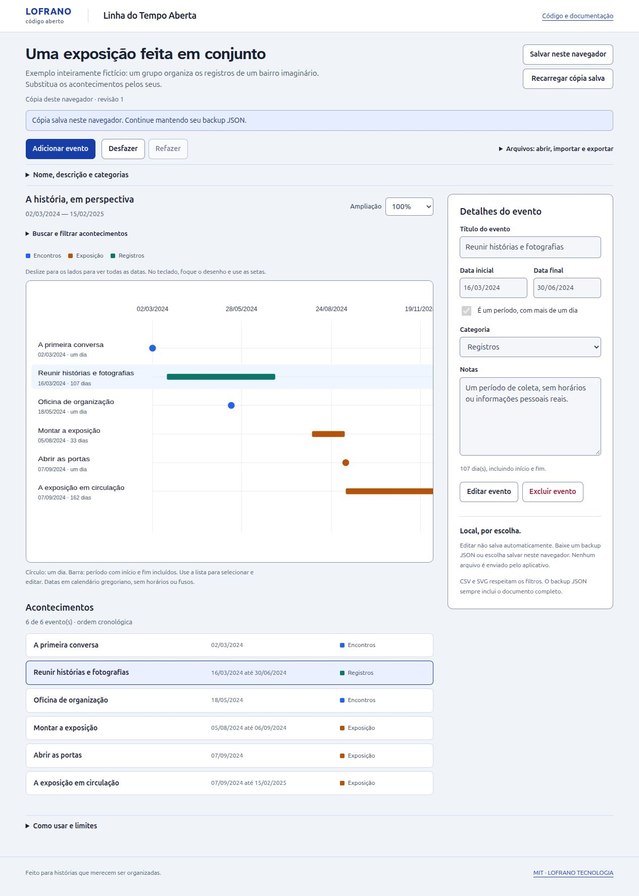

# Linha do Tempo Aberta

Editor visual em português para organizar acontecimentos e períodos em uma história, uma retrospectiva ou um projeto comunitário. **Datas civis exatas**, sem deslocar eventos por fuso horário.

[Abrir o editor](https://martinlofranodeoliveira.github.io/linha-do-tempo-aberta/) · [API reutilizável](API.md) · [Método e limites](METODO.md)


## O que faz

- Eventos de um dia ou períodos com início e fim incluídos.
- Até 200 eventos e 12 categorias, com busca sem distinção de acentos/maiúsculas e filtros por intervalo ou categoria.
- Linha do tempo vetorial proporcional aos dias, seleção compartilhada e lista textual equivalente.
- Edição, exclusão e histórico de até 20 edições para desfazer/refazer durante a sessão.
- Importação de JSON com prévia e confirmação. Cancelar preserva o documento.
- Salvamento **opcional** neste navegador, com transação IndexedDB e comparação de revisões contra alterações de outra aba.
- Backup JSON completo e exportações CSV/SVG dos eventos filtrados. SVG passivo, sem scripts, recursos ou imagens externas.

O exemplo “Uma exposição feita em conjunto” é inteiramente fictício. A ferramenta não cria fatos, traduz calendários históricos ou verifica se um acontecimento é verdadeiro.



[Ver a interface móvel](docs/editor-mobile.jpg) · [Baixar o exemplo JSON fictício](examples/historia-ficticia.json)

## Usar sem instalar bibliotecas

Requer um navegador moderno e um servidor estático, por exemplo Python 3:

```sh
git clone https://github.com/martinlofranodeoliveira/linha-do-tempo-aberta.git
cd linha-do-tempo-aberta
python3 -m http.server 5274 --bind 127.0.0.1
```

Abra `http://127.0.0.1:5274/`. Módulos JavaScript precisam de HTTP; `file://` não é suportado. A aplicação não chama serviços de rede depois de carregada. O primeiro acesso, atualizar a página e os links externos dependem da hospedagem ou do servidor local. **Não é uma PWA.**

Para preparar uma distribuição estática, com Node 22 ou 24, sem instalar dependências:

```sh
node scripts/build.mjs
python3 -m http.server 5274 --bind 127.0.0.1 --directory dist
```

O build cria uma pasta nova, sem apagar ou sobrescrever pastas existentes. Para outra saída, escolha um destino ainda inexistente: `node scripts/build.mjs --output outra-distribuicao`. Somente os arquivos autorais explicitamente listados, fontes locais licenciadas e avisos de licença entram na distribuição. Nenhum pacote Node é enviado ao navegador.

## Como organizar a história

1. Crie um evento ou carregue o exemplo fictício.
2. Informe título e data; marque “É um período” para incluir uma data final. Aplique em **Salvar evento**.
3. Edite o nome/descrição do documento e as categorias. Ao excluir uma categoria, os eventos são preservados e passam a ficar sem categoria.
4. Busque e filtre para apresentar uma parte da história. Um período que cruza o intervalo continua aparecendo. Use a rolagem horizontal para percorrer o desenho em telas estreitas ou ampliadas.
5. Baixe um **backup JSON**. Ele inclui o documento inteiro; CSV e SVG consideram os filtros atuais.

Campos ainda não aplicados nos formulários não entram nos arquivos. Exportar não publica nada. O JSON preserva os dados completos; o desenho pode abreviar rótulos, conservando títulos completos nas descrições do SVG.

## Dados locais e proteção entre abas

Editar mantém o documento na memória desta aba. Escolher **Salvar neste navegador** grava uma cópia no IndexedDB, no banco exclusivo `lofrano.linha-do-tempo-aberta.v1`. Uma transação compara a revisão lida e só então grava a seguinte. Se outra aba salvou antes, a gravação é recusada e seu trabalho permanece na memória para backup ou revisão.

Recarregar a cópia salva substitui o documento após confirmação quando há alterações. Isso encerra o histórico de desfazer/refazer; salvar não encerra. Falhas de espaço e corrupção não apagam nem substituem dados automaticamente. Em corrupção persistente, preserve o JSON válido da memória e gerencie os dados **deste site** nas configurações do navegador antes de importar novamente.

Não há conta, upload, telemetria, IA, sincronização entre dispositivos ou colaboração em nuvem. A hospedagem recebe os acessos normais aos arquivos estáticos. Limpar os dados do site, modo privado e falhas do dispositivo podem remover a cópia local; ela não substitui backups. Não use esta edição como único arquivo de uma pesquisa.

## Precisão e limites

- Calendário gregoriano calculado de `0001-01-01` a `9999-12-31`, sem horários ou fusos. Não converte calendários históricos.
- Períodos inclusivos: datas iguais significam um dia. Durações são dias reais, sem aproximar meses como 30 dias.
- Até 200 eventos, 12 categorias, 1 MiB por backup, profundidade 8 e 4.000 nós JSON. Títulos e notas têm os limites da [API](API.md).
- Entradas inválidas não são corrigidas/truncadas silenciosamente. Sobreposições são permitidas; não se trata de um validador de conflitos de agenda.
- CSV prefixa apóstrofo em células que planilhas poderiam interpretar como fórmulas. O prefixo pode ficar visível em outros leitores.
- Navegadores atuais com ESM, SVG e IndexedDB são o alvo. Se o armazenamento estiver indisponível, a edição na memória continua possível. Não há certificação de todos os navegadores, impressão ou acessibilidade integral.

## Desenvolvimento

Node 22 ou 24; dependências somente de desenvolvimento, fixadas no lockfile:

```sh
npm ci --ignore-scripts --no-audit --no-fund
npm test
```

Os testes cobrem calendário, JSON estrito, filtros, geometria, exportações, fluxo DOM e transações. A [contribuição](CONTRIBUTING.md) descreve a qualificação Linux offline em namespace: fonte/dependências somente leitura, hashes antes/depois, ausência de rede/home/credenciais e `CapEff=0`/`NoNewPrivs=1`. Instalar dependências é uma etapa anterior com rede. A CI verifica o mesmo processo; não exige sudo no computador local.

O engine pode ser usado sem DOM, armazenamento ou bibliotecas:

```js
import { parseDocument, layoutTimeline, renderSVG } from './src/engine.js';
const document = parseDocument(seuTextoJSON);
const layout = layoutTimeline(document);
const svg = renderSVG(document, { query: 'exposição' });
```

## Código aberto

[MIT](LICENSE), com [atribuições e licenças das fontes](THIRD_PARTY_NOTICES.md). Contribuições e regressões reproduzíveis com dados fictícios são bem-vindas. Preserve o tratamento de datas civis, os backups portáveis e a privacidade.

Parte do laboratório de software aberto da [LOFRANO TECNOLOGIA](https://lofranotecnologia.com.br). Ferramenta reutilizável da comunidade, sem dados ou aplicação privada de clientes.
